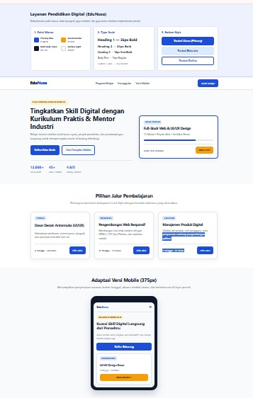
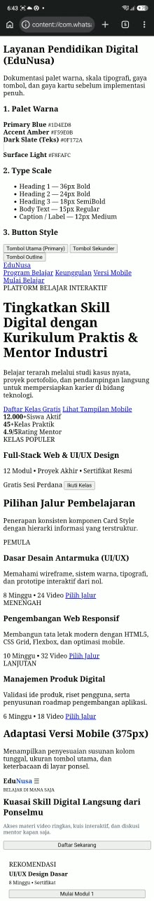

# High Fidelity Mockup & Mini Design System — Layanan Pendidikan Digital (EduNusa)

Proyek ini merupakan pengembangan *wireframe* menjadi *mockup high fidelity* untuk layanan pendidikan digital (**EduNusa**) menggunakan HTML5 dan CSS3. Desain ini dilengkapi dengan dokumentasi *Mini Design System* (palet warna, *type scale*, *button style*, dan *card style*), hierarki visual yang jelas bagi calon investor, serta adaptasi tampilan versi *mobile* (`375px`).

## Ringkasan Pengembangan, Masalah, dan Solusi

Pengembangan halaman ini berfokus pada transformasi kerangka *wireframe* dasar menjadi antarmuka *high fidelity* yang merepresentasikan identitas visual platform pendidikan digital secara profesional sebelum memasuki tahap pengembangan penuh. Tujuan utamanya adalah memastikan calon investor maupun pengguna dapat langsung memahami nilai produk, struktur informasi, dan alur tindakan utama (*call-to-action*) pada halaman.

Selama proses perancangan, terdapat beberapa tantangan yang harus diselesaikan. Pertama, tata letak *wireframe* awal belum memiliki penekanan hierarki visual sehingga judul utama, informasi program belajar, dan tombol ajakan bertindak tampak memiliki bobot yang seragam. Kedua, komponen antarmuka seperti tombol dan kartu program belajar berpotensi terlihat tidak konsisten apabila tidak didefinisikan dalam aturan gaya yang baku. Ketiga, susunan multi-kolom pada layar *desktop* menjadi terlalu padat dan sulit dibaca ketika dibuka pada layar perangkat *mobile*.

Untuk mengatasi permasalahan tersebut, disusun *Mini Design System* menggunakan variabel CSS (`:root`) yang menetapkan palet warna utama biru dan aksen kuning keemasan, skala tipografi bertingkat (*type scale*), tiga variasi gaya tombol (*primary*, *secondary*, dan *outline*), serta komponen *card style* dengan bayangan halus dan batas tegas. Selain itu, diterapkan tata letak CSS Grid responsif serta simulasi bingkai layar *mobile* (`375px`) agar struktur konten berubah menjadi satu kolom dengan tombol lebar penuh yang nyaman digunakan pada ponsel.

## Struktur Folder

```text
edu-high-fidelity/
├── index.html
├── css/
│   └── style.css
├── Dokumentasi/
│   ├── desktop.png
│   └── mobile.png
└── README.md
```

## Komponen Design System yang Diterapkan

1. **Palet Warna:**
   * **Primary Blue (`#1D4ED8`):** Digunakan untuk identitas merek, tombol utama, dan penekanan informasi penting.
   * **Accent Amber (`#F59E0B`):** Digunakan untuk label sorotan (*pill*/*badge*) dan tombol aksi sekunder pada kartu unggulan.
   * **Dark Slate (`#0F172A`):** Digunakan untuk teks utama agar memiliki kontras tinggi dan nyaman dibaca.
   * **Surface Light (`#F8FAFC`):** Digunakan sebagai latar belakang halaman yang bersih dan modern.
2. **Type Scale (Hierarki Tipografi):**
   * **Heading 1 (`36px` Bold):** Judul utama pada bagian *Hero*.
   * **Heading 2 (`24px–26px` Bold):** Judul setiap bagian halaman.
   * **Heading 3 (`18px` SemiBold):** Judul kartu program pembelajaran.
   * **Body Text (`15px` Regular):** Teks deskripsi program dan penjelasan.
   * **Caption / Label (`12px` Medium/Bold):** Tag kategori dan metadata durasi kelas.
3. **Button Style & Card Style:**
   * Variasi tombol *Primary*, *Secondary*, *Accent*, dan *Outline* dengan sudut membulat (`10px`) dan efek transisi *hover*.
   * Komponen kartu (`course-card`) dengan *padding* terukur, garis tepi lembut, indikator progres belajar, dan *footer* kartu yang sejajar.

## Dokumentasi Hasil Mockup

### Tampilan Desktop & Design System


### Tampilan Adaptasi Mobile (375px)


## Catatan Tugas

* **Jenis Tugas:** Tugas Individu — Pengembangan *Wireframe* ke *Mockup High Fidelity*.
* **Kelengkapan:** *Mini Design System* (palet warna, *type scale*, *button style*, *card style*), halaman *mockup* layanan pendidikan digital versi *desktop*, dan simulasi adaptasi *mobile*.